## 1. Abstract

The Loan Default Prediction System scores a loan application at the moment it is made. For each applicant it returns a probability of default (PD), one of three decisions (APPROVE, REVIEW or REJECT) and up to three plain-language reasons for the score. It has two parts. A Python pipeline (pandas, scikit-learn, XGBoost) cleans and splits the data, trains and compares three models and explains the chosen one with SHAP. A FastAPI service scores applications in real time, writes every prediction to a SQLite log and checks that new applicants still look like the training data, using the Population Stability Index (PSI) and an Evidently HTML report. A kill switch turns every decision into REVIEW. The system runs on a Windows laptop. There is no cloud deployment, no web front end (the Swagger UI at `/docs` is the interface) and no login.

The data is the public Kaggle "Credit Risk Dataset" by laotse: 32,581 loans, 12 columns, 7,108 defaults (21.8%). The records are simulated credit-bureau data with no names, ids or addresses. Three cleaning rules remove 172 rows (165 exact duplicates, 5 ages above 100 and 2 employment lengths above 60 years) and leave 32,409. Missing values (895 employment lengths and 3,116 interest rates) are kept and filled inside the model pipeline. The data is split 70/15/15 into 22,686 training, 4,861 validation and 4,862 test loans, stratified so each part has a 21.9% default rate.

Logistic regression, random forest and XGBoost were trained, each as one scikit-learn Pipeline that includes its own preprocessing. XGBoost had the best validation ROC-AUC (0.9511) and was chosen before the test set was opened. On the 4,862 test loans it reaches ROC-AUC 0.9469 (Gini 0.8938, KS 0.7525). Five-fold cross-validation on all cleaned data gives 0.9497 with a standard deviation of 0.0024. Without the lender's own grade and interest rate the test AUC is 0.9020.

The business result comes from a back-test on the test set. The lender's grade A to C rule approves 85.5% of applicants, and 17.75% of the money lent ends up in default (the NPA ratio by amount). Approving the same 85.5% of applicants by lowest model PD gives 8.12%, which is 54.3% lower. With the cut-offs PD below 0.20 (APPROVE) and PD of 0.50 or more (REJECT), the APPROVE band holds 75.3% of applicants and 5.0% of them default, while the REJECT band holds 16.4% and 97.0% of them default.

All 1,201 REVIEW and REJECT decisions on the test set carry at least one risk-raising reason. The 95th-percentile round trip of `POST /predict` is 45.6 ms over 500 requests. Simulated downturn traffic (incomes down 20%, interest rates up 2 points) raises drift alerts on `loan_int_rate` (PSI 1.178) and on the decision mix, and normal traffic raises none. All 13 automated tests pass. These numbers describe simulated data with a 21.8% default rate, far above the roughly 1.8% gross NPA ratio of Indian banks, so they show that the method works and how large the relative gain is. They do not show what a real lender would earn. Section 17 lists the limitations.

**Keywords:** credit risk, probability of default, gradient boosting, XGBoost, SHAP, explainable AI, PSI drift monitoring, FastAPI, NPA, RBI Fair Practices Code.

---

## 2. Introduction and problem statement

Many lenders still decide with simple rules built on a risk grade from A (best) to G (worst). A grade is blunt: in the data used here the default rate is 20.7% in grade C and 59.0% in grade D, one grade covers very different applicants, and a refused applicant gets no specific reason. Banks measure the damage as the non-performing asset (NPA) ratio, the defaulted amount as a share of the amount lent. The project asks one question: if the lender approved the same number of applicants but chose them by the model's probability of default (PD) instead of by grade, how much lower would the NPA ratio be?

### 2.1 Problem statement (5W1H)

| Question | Answer |
|---|---|
| **Who** faces the problem? | Credit-risk managers and loan officers at a lender (a bank or a non-bank finance company) who approve or refuse every application. Applicants are owed a reason when they are refused. Model-risk and compliance staff must be able to audit the decisions. |
| **What** is the problem? | Approval by grade alone is blunt: the grade A to C rule approves 85.5% of applicants and 17.75% of the money lent defaults. Refused applicants get no specific reason, and nobody is told when the applicant mix changes. |
| **When / where** does it occur? | At application time, for every application and channel, and afterwards, because the applicant mix drifts over time. |
| **Why** does it matter? | Each default loses principal and interest and raises the NPA ratio. Regulators and customers expect reasons for a refusal (RBI Fair Practices Code), and a model that degrades silently is a risk of its own. |
| **How** is it solved here? | Three models are compared and XGBoost gives the PD. Two cut-offs turn it into APPROVE, REVIEW or REJECT. SHAP supplies up to three reasons. A FastAPI service validates, scores and logs each application and reports drift. A kill switch sends every decision to a person. |

### 2.2 Scope

In scope: cleaning and splitting, three trained models, evaluation on held-out data with the NPA back-test, SHAP reasons, the scoring API with input validation, the SQLite log, PSI drift monitoring, the kill switch and 13 automated tests. Out of scope: a web front end, user accounts, cloud hosting, real lender data, models for loss given default and exposure at default, credit limits and pricing, a fairness audit, reject inference and automated retraining (section 17).

### 2.3 A note on the tools

The project uses Python with pandas (McKinney, 2010) and scikit-learn for the data work, XGBoost for the deployed model, SHAP for explanations, FastAPI with Pydantic for the service, SQLite for the prediction log and Evidently for the drift report. FastAPI produces the Swagger UI from the code, so the service has an interface without a front end, and SQLite is a file, so no database server is needed. PSI is a few lines of NumPy, written in `src/drift.py` and tested; Evidently is used only for the HTML report. There is no front end or cloud hosting because the project is individual, runs for four weeks and must demonstrate on a laptop; the cost is stated in section 17.

---

## 3. Objectives

The first six objectives are measurable. Each is followed by its target and by the result measured on 1 November 2026.

1. **Discrimination.** Test ROC-AUC of at least 0.85 on loans the model never saw. Result: 0.9469 (XGBoost).
2. **Business value.** Cut the NPA ratio by amount by at least 30% against the grade A to C rule, at the same approval rate. Result: 54.3% lower (17.75% to 8.12%).
3. **Explanations.** At least one plain-language reason for 100% of REVIEW and REJECT decisions. Result: 1,201 of 1,201 on the test set.
4. **Speed.** 95th-percentile latency of `POST /predict` below 100 ms. Result: 45.6 ms over 500 requests.
5. **Monitoring.** A drift alert on simulated downturn traffic and none on normal traffic. Result: alerts on `loan_int_rate` (PSI 1.178) and `decision_mix` for the downturn, no alert for normal traffic.
6. **Stability.** Standard deviation of the 5-fold cross-validated AUC below 0.01. Result: 0.0024.
7. **Safe operation.** Validate every request (HTTP 422 for bad input), log every prediction to SQLite, and provide a kill switch that sends every decision to REVIEW. Result: all three work (section 13.3).
8. **Tests.** Automated tests for cleaning, splitting, the AUC target, SHAP additivity, calibration by decile, input validation, the kill switch and the drift alert. Result: 13 tests, 13 passed.
9. **Documentation and ethics.** Deliver the cleaned dataset, a data dictionary, an EDA notebook with at least three charts (this project has six), this report, and an ethics statement that covers data licence, privacy, explainability, human oversight and fairness.

---

## 4. Literature and industry context

### 4.1 Credit scoring and the probability of default

Credit scoring means estimating, from an applicant's data, the chance that the applicant will not repay. Hand and Henley (1997) review the statistical methods used in consumer credit. For decades the standard has been the scorecard: a logistic regression on binned inputs, converted to points that a loan officer can read and a regulator can audit (Siddiqi, 2017; Thomas, Crook and Edelman, 2017). Its output is a probability of default (PD) over a fixed horizon. Lessmann et al. (2015) compared more than 40 classifiers on several credit-scoring data sets and found that ensemble methods generally rank applicants better than logistic regression alone, at the cost of direct interpretability. This project follows that line: a logistic regression as the baseline, a random forest and a gradient-boosting model as stronger candidates, and SHAP so that the strongest model can still give reasons.

### 4.2 Expected loss and the Basel IRB approach

Under the internal-ratings-based (IRB) approach of Basel II, a bank's expected loss on a loan is PD × LGD × EAD: the probability of default, the loss given default (the share of the exposure lost if the borrower defaults) and the exposure at default (the amount outstanding at that moment). The Basel Committee (2005) explains how the IRB risk-weight formulas build on these inputs. In the foundation approach the supervisor fixes LGD at 45% for senior unsecured claims. This project estimates only PD, because the dataset has no recovery or exposure data. The 45% still helps with one decision. If a loan earns interest rate r when repaid and loses LGD when it defaults, the lender breaks even where (1 − PD) × r = PD × LGD, so PD = r / (r + LGD). With the data's average rate of 11% and an LGD of 45% this is 0.11 / 0.56 = 0.196, which is where the APPROVE cut-off of 0.20 comes from. The calculation ignores funding cost, fees and collateral. It is a starting point for a lender's own policy, not a rule.

### 4.3 Gradient boosting and XGBoost

Gradient boosting builds a model as a sum of many small decision trees, each fitted to the errors left by the trees before it (Friedman, 2001). XGBoost (Chen and Guestrin, 2016) is a widely used implementation with regularisation, built-in handling of missing values and fast histogram-based training. Random forests (Breiman, 2001) average many deep trees grown on random samples and are a strong, simple comparison. The logistic regression and random forest come from scikit-learn (Pedregosa et al., 2011), and XGBoost is used through its scikit-learn wrapper, so all three fit the same Pipeline interface. Quality is judged with ROC-AUC (Fawcett, 2006), the chance that a random defaulter scores higher than a random repayer, and four measures that lenders use for scorecards: Gini (2 × AUC − 1), KS (the largest gap between the cumulative score curves of defaulters and repayers), PR-AUC (precision against recall) and the Brier score (the mean squared error of the probabilities, a check on calibration).

### 4.4 SHAP explanations and adverse-action reasons

SHAP gives each feature a contribution to one prediction, based on Shapley values from cooperative game theory (Lundberg and Lee, 2017). For tree models TreeSHAP computes them exactly and quickly (Lundberg et al., 2020). The contributions plus a base value add up exactly to the model's raw score, and a positive contribution pushes the applicant towards default. Lenders need this because refusing credit normally requires telling the applicant why. In the United States, the Equal Credit Opportunity Act and Regulation B require a statement of the specific reasons for an adverse action (Consumer Financial Protection Bureau, 12 CFR 1002.9). In India, the RBI's Fair Practices Code expects a lender to treat applicants fairly and to explain a refusal (section 4.6). The largest positive SHAP contributions are a standard source of such reasons, and section 10 shows how this project turns them into fixed phrases.

### 4.5 Drift monitoring and the Population Stability Index

A model is trained on past applicants and used on future ones. If the applicant mix moves, in a recession or with a new product or channel, the model can get worse without any error message. The Population Stability Index compares the share of applicants in each bin today (a_i) with the share at training time (e_i): PSI = sum over bins of (a_i − e_i) × ln(a_i / e_i). A common rule of thumb reads below 0.10 as stable, 0.10 to 0.25 as a shift to watch and 0.25 or more as a large shift (Siddiqi, 2017). Yurdakul (2018) studies the statistical properties of the index and shows that these thresholds are conventions, not significance tests. This project bins numeric features into training deciles, uses category shares for categorical ones, applies the same index to the model's score and adds an alert when the approval share moves more than 10 percentage points from its validation baseline. Evidently produces a full HTML report.

### 4.6 RBI norms: NPA and the Fair Practices Code

In India, the RBI's income-recognition and asset-classification norms treat a loan as a non-performing asset when interest or principal stays overdue for more than 90 days, and the gross NPA ratio is the stock of NPAs as a share of gross advances. The NPA ratio in this report has the same shape: the defaulted amount divided by the amount lent, over the approved loans. The dataset does not say how many days a loan was overdue, so "default" here is the dataset's label and not the RBI's 90-day test. The RBI's Fair Practices Code for lenders sets out how lenders should deal with applicants, including telling an applicant why an application was not accepted. The text that applies depends on the type of lender and should be checked in the current RBI circulars. The project follows its intent by returning reasons with every decision.

---

## 5. Dataset

### 5.1 Source and columns

The data is the Kaggle dataset "Credit Risk Dataset" by laotse ({{dataset_source}}). The file `credit_risk_dataset.csv` has 32,581 rows and 12 columns. Each row is one loan application with the applicant's profile, the loan terms, the lender's grade and the outcome. The records are simulated credit-bureau data and contain no names, account numbers, addresses or contact details. The licence is the one shown on the dataset's Kaggle page. The file is used here for study and is cited with its link. It is not copied into the repository: the `data/` folder is git-ignored, and `src/data_prep.py` stops with a clear message and the download link if the file is missing.

| Column | Type | Values in the raw file | Meaning |
|---|---|---|---|
| `person_age` | int | 20 to 144 | Applicant's age in years |
| `person_income` | int | 4,000 to 6,000,000 | Annual income |
| `person_home_ownership` | category | RENT 16,446; MORTGAGE 13,444; OWN 2,584; OTHER 107 | Housing status |
| `person_emp_length` | float | 0 to 123; 895 missing | Years in the current job |
| `loan_intent` | category | EDUCATION, MEDICAL, VENTURE, PERSONAL, DEBTCONSOLIDATION, HOMEIMPROVEMENT | Purpose of the loan |
| `loan_grade` | category | A 10,777; B 10,451; C 6,458; D 3,626; E 964; F 241; G 64 | Lender's risk grade, A best |
| `loan_amnt` | int | 500 to 35,000 | Amount requested |
| `loan_int_rate` | float | 5.42 to 23.22 (percent a year); 3,116 missing | Interest rate offered |
| `loan_status` | int | 0 repaid (25,473); 1 defaulted (7,108) | Target label |
| `loan_percent_income` | float | 0.00 to 0.83 | Loan amount divided by income |
| `cb_person_default_on_file` | category | Y 5,745; N 26,836 | Past default on the credit-bureau file |
| `cb_person_cred_hist_length` | int | 2 to 30 | Years of credit history |

### 5.2 Quality findings

The notebook `notebooks/01_eda.ipynb` checks the raw file before any cleaning. The counts below come from that notebook and from `src/data_prep.py`.

| Finding | Count | Share of 32,581 rows | Action |
|---|---:|---:|---|
| Missing `person_emp_length` | 895 | 2.7% | Kept; filled with the training median inside the pipeline |
| Missing `loan_int_rate` | 3,116 | 9.6% | Kept; filled with the training median inside the pipeline |
| Exact duplicate rows | 165 | 0.5% | Removed |
| `person_age` above 100 (values 123 and 144) | 5 | 0.02% | Removed |
| `person_emp_length` above 60 years (both 123) | 2 | 0.01% | Removed |
| Income above 1,000,000 | 9 | 0.03% | Kept (large but possible; one of them belongs to an age-144 row that is removed) |
| Defaulted loans | 7,108 | 21.8% | Kept; the target is imbalanced, so models are judged by AUC, PR-AUC and KS |
| Grade G loans | 64 | 0.2% | Kept; the 98.4% default rate of grade G rests on few loans |

No other column has missing values. The file has no date column, so it cannot be split by time and drift cannot be observed over time (section 17).

### 5.3 What the data does and does not represent

The default rate of 21.8% is far above the roughly 1.8% gross NPA ratio of Indian banks quoted in the project README. A real lender's book would have far fewer defaults, and its applicants would not have been pre-screened in the same way. The data also contains only granted loans with known outcomes, so it says nothing about applicants who were refused. Two consequences follow. Absolute NPA numbers in this report do not transfer to a real lender, and only the relative gain between two policies on the same data is meaningful. The model must not be used to take real credit decisions.

---

## 6. Data cleaning and splitting

### 6.1 Cleaning rules

`src/data_prep.py` applies three rules in a fixed order. A row is counted under the first rule that removes it.

| Rule | What is wrong | Action | Rows removed |
|---|---|---|---:|
| R1 | Exact duplicate row | Dropped (first copy kept) | 165 |
| R2 | `person_age` above 100 (123 or 144 years) | Dropped | 5 |
| R3 | `person_emp_length` above 60 years (123 years); a missing value is not touched | Dropped | 2 |
| | **Total** | 32,581 rows in, 32,409 rows out | **172** |

**Why these rules.**

- Duplicates are removed first because an exact copy adds no information and, if one copy fell in the training part and the other in the test part, it would leak the answer.
- An age of 123 or 144 years is a data-entry error. The cut-off is 100 and not a lower number, because ages in the 80s and 90s are possible: the oldest remaining applicant is 94.
- An employment length above 60 years is impossible. The two rows both show 123 years and belong to applicants aged 21 and 22, so the value is a data-entry error.
- Missing values are not rows to throw away. Dropping the 3,116 rows without an interest rate would remove 9.6% of the data, and the scoring API must be able to score an applicant whose rate is not yet set. The rows stay, and the pipelines fill the gaps (section 8).
- Large incomes are kept. Tree models are not sensitive to a few large values, and the 9 rows above 1,000,000 are possible for high earners.

**Outcome.** 172 of 32,581 rows (0.53%) are removed. The cleaned file has 32,409 rows, 7,088 defaults (21.9%), 887 missing employment lengths and 3,094 missing interest rates. The oldest applicant is 94, the longest employment is 41 years and the highest income is 2,039,784.

### 6.2 Splitting and data files

The cleaned data is split twice with scikit-learn's `train_test_split`, always stratified on `loan_status` and always with the seed 42. First 30% is set aside. That part is then split in half. The result is a 70/15/15 split:

| Part | Rows | Defaults | Default rate | Missing employment length | Missing interest rate | Used for |
|---|---:|---:|---:|---:|---:|---|
| Train | 22,686 | 4,962 | 21.9% | 616 | 2,197 | Fitting the imputers, encoders and models |
| Validation | 4,861 | 1,063 | 21.9% | 140 | 455 | Choosing between the three models |
| Test | 4,862 | 1,063 | 21.9% | 131 | 442 | Final evaluation, used once |

**Rules of use.** Everything that learns from data (medians, scaling, category lists, trees) is fitted on the training part only. The validation part decides which model is deployed. The test part is opened only after that choice is made, and no setting was changed after seeing test results. The three files are written to `data/processed/` as `train.csv`, `val.csv` and `test.csv`. A test in `tests/test_data.py` checks the three sizes, that the default rates differ by less than 0.5 points, and that no loan appears in two parts.

**Data files.** Two CSV files are part of the submission. `dataset.csv` holds the 32,409 cleaned rows with the 12 original columns in their original order. `data_dictionary.csv` has one row per column with its type, three sample values, whether it can be empty, and a description in plain words that includes the range after cleaning and how the column is used in the model.

---

## 7. EDA findings

The exploratory analysis is the executed notebook `notebooks/01_eda.ipynb`. It checks the quality of the raw file and looks at how default varies with grade, purpose and the numeric columns. The six charts are saved at 150 dpi in `reports/eda/`.

### 7.1 The target: how many loans defaulted

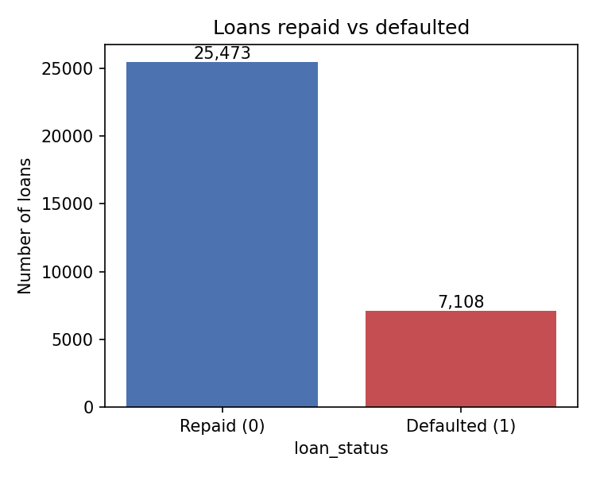

**Reading the chart.** 7,108 of 32,581 loans defaulted, a default rate of 21.8%. A model that predicted "repaid" for everyone would be right 78.2% of the time and would be useless for the lender, so accuracy is not used to judge the models (section 7.5).

### 7.2 Missing values and outliers

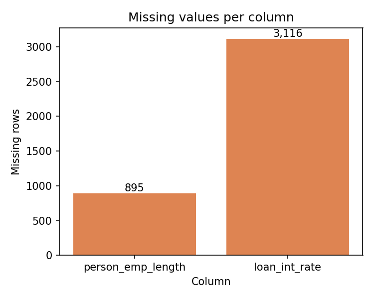

**Reading the chart.** Only two columns have gaps: `person_emp_length` (895 rows, 2.7%) and `loan_int_rate` (3,116 rows, 9.6%). The missing rate probably means the loan was not yet priced, as the API describes the field. Because 9.6% is too much to discard and the API must accept an applicant without a rate, the gaps are filled with the training median inside each pipeline and not removed.

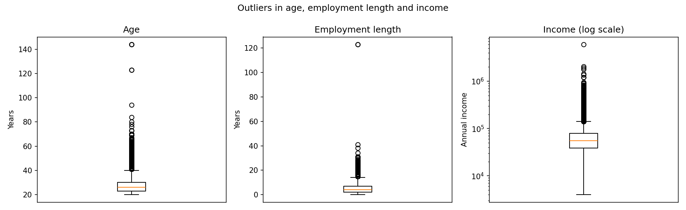

**Reading the chart.** The middle half of applicants is aged 23 to 30 (median 26), has 2 to 7 years in the current job (median 4) and earns 38,500 to 79,200 (median 55,000). Around that core, a few points are impossible: ages of 123 and 144 and an employment length of 123 years. Income runs from 4,000 to 6,000,000, hence the log scale. The notebook counts 165 exact duplicates, 5 ages above 100 and 2 employment lengths above 60 years; these 172 rows are removed in section 6.

### 7.3 Default rate by grade and by purpose

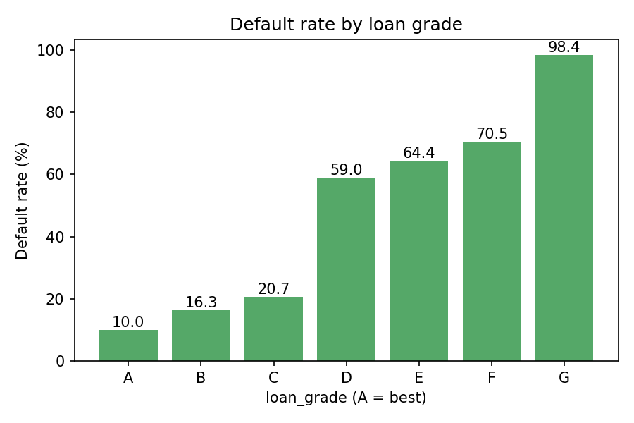

**Reading the chart.** The default rate is 10.0% in grade A, 16.3% in B and 20.7% in C, then jumps to 59.0% in D, 64.4% in E, 70.5% in F and 98.4% in G. Grades A to C hold 85.0% of all loans. The grade is a strong signal but a blunt one: nearly all of the separation happens at one step, between C and D. Two facts in the raw file explain this. The mean interest rate rises with the grade, from 7.33% in A to 20.25% in G, and grades A and B contain no applicant with a past default on file while about half of the applicants in each grade from C to G have one. The grade therefore carries rate and bureau history, which is why section 9.5 reports a model without the grade and the rate.

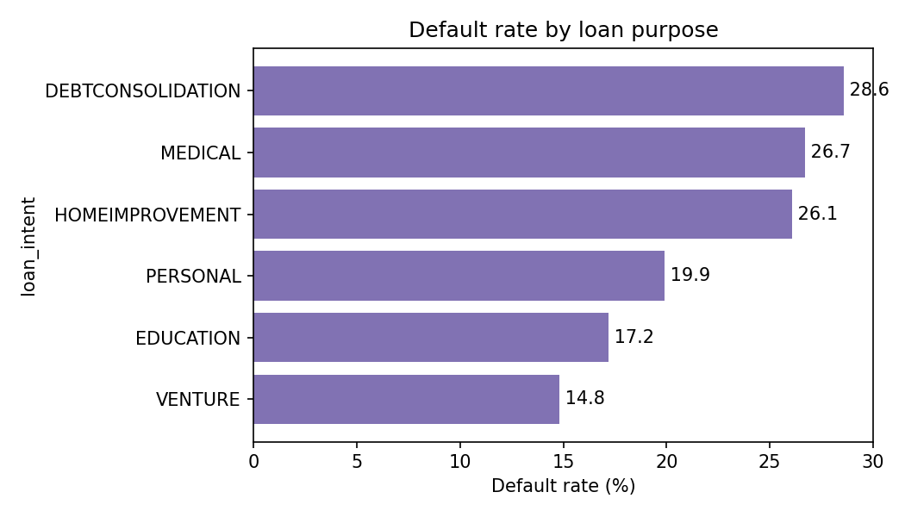

**Reading the chart.** Loans for a venture default least (14.8%) and loans for debt consolidation most (28.6%), with education (17.2%), personal (19.9%), home improvement (26.1%) and medical (26.7%) in between. The spread is 13.8 points, against 88.4 points between grade A and grade G, so the purpose matters far less than the grade. Two columns without a chart also separate the groups (raw file): renters default at 31.6% against 12.6% for mortgage holders and 7.5% for owners, and applicants with a past default on file at 37.8% against 18.4% for those without.

### 7.4 Correlation between numeric columns

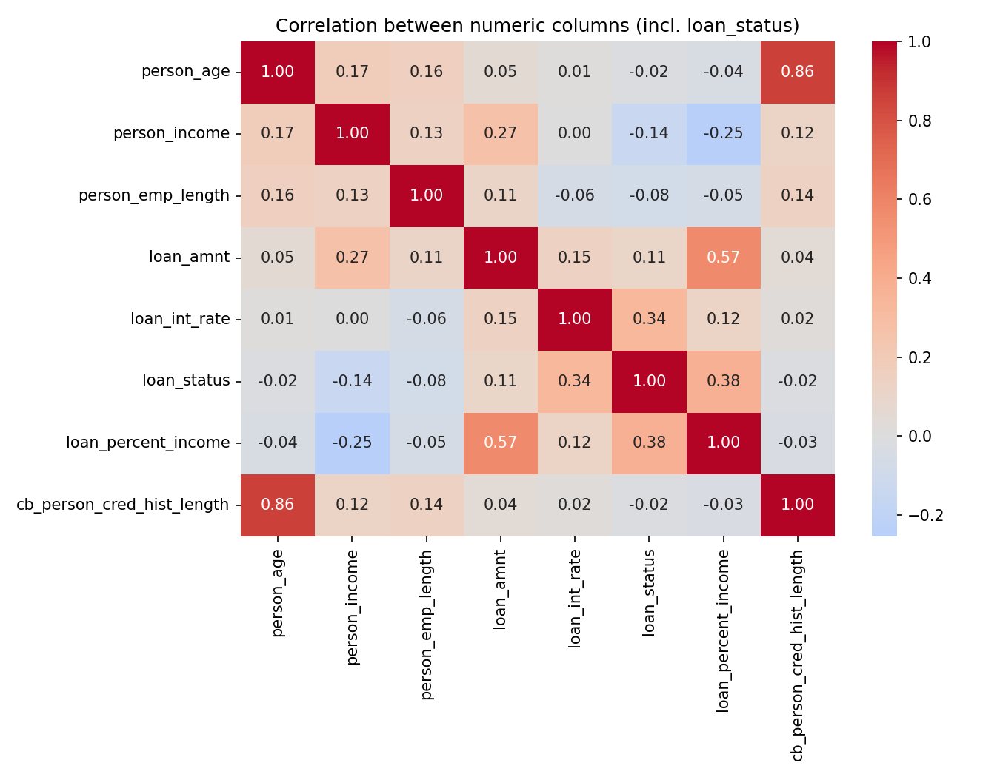

**Reading the chart.** The numeric columns most correlated with default are `loan_percent_income` (0.38) and `loan_int_rate` (0.34). Income (−0.14) and employment length (−0.08) lower the risk, `loan_amnt` raises it slightly (0.11), and age and credit-history length (−0.02 each) have almost no linear link. Correlation measures only straight-line relations, so it understates the grade effect, which is a step and not a slope. Among the inputs, age and credit-history length move together (0.86), and the loan-to-income ratio follows the loan amount (0.57) and falls with income (−0.25), as it must.

### 7.5 What the EDA changed in the design

- The target is imbalanced (21.8%), so models are judged by ROC-AUC, PR-AUC and KS, which do not reward the "repaid for everyone" shortcut, and every split is stratified. Gaps are filled inside each pipeline, and three rules remove the impossible rows.
- The grade and the rate dominate the raw picture, so the grade A to C rule is the back-test baseline and an ablation without both columns is run.
- The loan-to-income ratio correlates most with default, so the API computes it itself. The file has no dates, so drift is simulated with a stressed copy of the data.

---

## 8. Model development

### 8.1 Three pipelines

Three candidate models are trained on the same training rows, each inside one scikit-learn `Pipeline` that holds the preprocessing and the estimator. All settings are in `src/train.py`.

| Pipeline | Preprocessing | Estimator and settings |
|---|---|---|
| Logistic regression | Numeric columns: median fill, then standardisation. Categorical columns: one-hot encoding (unknown categories ignored) | `LogisticRegression(max_iter=2000, class_weight="balanced")` |
| Random forest | Numeric columns: median fill. Categorical columns: ordinal integer codes (unknown categories coded -1) | `RandomForestClassifier(n_estimators=400, min_samples_leaf=2, class_weight="balanced_subsample", n_jobs=-1, random_state=42)` |
| XGBoost (deployed) | Same as the random forest | `XGBClassifier(n_estimators=600, learning_rate=0.05, max_depth=5, subsample=0.8, colsample_bytree=0.8, eval_metric="auc", n_jobs=-1, random_state=42)` |

### 8.2 Preprocessing and the single Pipeline object

The 11 model inputs are 7 numeric columns (`person_age`, `person_income`, `person_emp_length`, `loan_amnt`, `loan_int_rate`, `loan_percent_income`, `cb_person_cred_hist_length`) and 4 categorical columns (`person_home_ownership`, `loan_intent`, `loan_grade`, `cb_person_default_on_file`). The target is `loan_status`.

- **Missing values.** Numeric gaps are filled with the training median (4.0 years for employment length, 10.99% for the interest rate). The medians are learned when the pipeline is fitted, so nothing from validation or test data leaks in.
- **Logistic regression** needs a common scale and one column per category value, so it gets standardisation and one-hot encoding.
- **Tree models** need no scaling. They get one integer column per categorical feature, which keeps one column per original feature and so gives SHAP one contribution per feature. The integer codes (alphabetical order) carry an arbitrary order, but a tree can still isolate any category with a few splits.

**One Pipeline object.** The fitted pipeline, with its imputer medians, encoders and model, is saved as one file, `models/model_v1.joblib`. The API loads that object once at start-up and calls `predict_proba` on a raw table of 11 columns. There is no second copy of the preprocessing code that could differ from the training code, which removes a common source of silent errors between training and serving.

### 8.3 Why no SMOTE or other resampling

The default share of 21.9% is a moderate imbalance. Oversampling methods such as SMOTE create synthetic applicants, which shifts the predicted probabilities away from the real default rate. Here the probability itself is used: the cut-offs 0.20 and 0.50 are probabilities, and the monitoring compares PD distributions. So the deployed XGBoost is trained on the real class mix with the normal loss, and its Brier score (0.0529 on test) is the lowest of the three. The logistic regression and random forest use class weights, which also raise their predicted probabilities, but they are only baselines. A test in `tests/test_model.py` checks the deployed model's calibration by decile.

### 8.4 Selection on the validation set

Each pipeline is fitted on the 22,686 training rows and scored on the 4,861 validation rows. The highest validation ROC-AUC wins. All three pipelines are saved in `models/candidates/` so that the test set can report all three later, and the winner is saved as `models/model_v1.joblib` with `models/metadata_v1.json`.

| Model | ROC-AUC | Gini | PR-AUC | KS | Brier | Training time (s) |
|---|---:|---:|---:|---:|---:|---:|
| Logistic regression | 0.8789 | 0.7579 | 0.7262 | 0.6091 | 0.1367 | 0.2 |
| Random forest | 0.9368 | 0.8736 | 0.8949 | 0.7537 | 0.0587 | 3.0 |
| **XGBoost** | **0.9511** | **0.9022** | **0.9102** | **0.7724** | **0.0507** | 2.2 |

**Reading the numbers.** XGBoost is best on every measure. The step from logistic regression to random forest is large (AUC +0.0579) and the step from random forest to XGBoost is smaller (+0.0143). The gap between the linear model and the tree models points to non-linear structure, for example the jump in default between grades C and D. Training takes 0.2 to 3.0 seconds on 16 logical CPUs. `metadata_v1.json` records the model name, the 11 feature names, the validation metrics, the 22,686 training rows and the training default rate (0.2187), and the API returns it at `GET /model/info`.

---

## 9. Evaluation

All numbers in this section come from the 4,862 test loans that played no part in training or model choice. `src/evaluate.py` produces them and saves them to `reports/evaluation.json`.

### 9.1 Test metrics

| Model | ROC-AUC | Gini | PR-AUC | KS | Brier |
|---|---:|---:|---:|---:|---:|
| Logistic regression | 0.8614 | 0.7229 | 0.6946 | 0.5884 | 0.1432 |
| Random forest | 0.9291 | 0.8582 | 0.8792 | 0.7227 | 0.0625 |
| **XGBoost (deployed)** | **0.9469** | **0.8938** | **0.9028** | **0.7525** | **0.0529** |

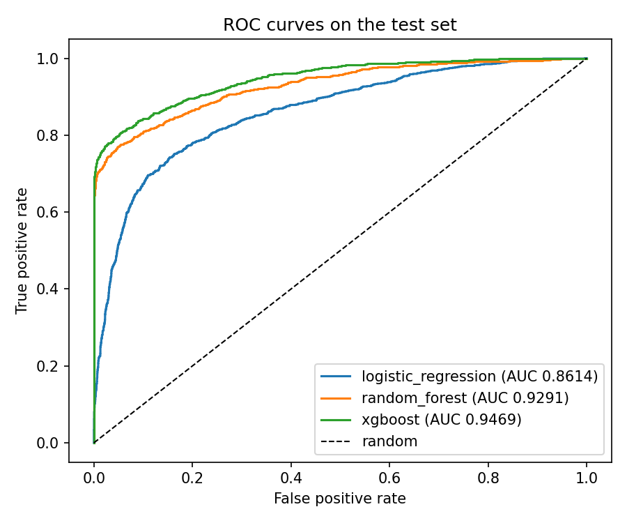

**Reading the chart.** The XGBoost curve lies above the other two at every point and climbs steeply on the left: it finds most defaulters before it flags many repayers. Its AUC of 0.9469 means that a random defaulter gets a higher score than a random repayer 94.7% of the time. The ranking of the models matches validation. Every model scores a little lower on test: logistic regression by 0.0175, random forest by 0.0077 and XGBoost by 0.0042, so choosing XGBoost on validation did not overfit that part. A random scorer would reach a PR-AUC of about 0.22 (the default rate), so 0.9028 is a large gain.

### 9.2 Risk bands

The deployed PD is turned into a decision with two cut-offs set in `src/config.py`: PD below 0.20 is APPROVE (band "low"), 0.20 up to 0.50 is REVIEW ("medium"), and 0.50 or more is REJECT ("high").

| Decision | PD range | Applicants | Share of test set | Actual default rate |
|---|---|---:|---:|---:|
| APPROVE | below 0.20 | 3,661 | 75.3% | 5.0% |
| REVIEW | 0.20 to below 0.50 | 402 | 8.3% | 26.1% |
| REJECT | 0.50 or more | 799 | 16.4% | 97.0% |

**Reading the table.** The bands order the applicants correctly: the actual default rate rises from 5.0% to 26.1% to 97.0%. About 3% of the rejected applicants would have repaid. The REVIEW band is the grey zone: 26.1% of its applicants default, close to the overall rate, so the model has no strong view and a loan officer should look at each case. The 402 REVIEW and 799 REJECT loans together are the 1,201 cases that need reasons (objective 3). The applicant counts were computed from the saved model on `test.csv`; shares and default rates are as printed by `src/evaluate.py`.

### 9.3 NPA back-test against the lender's grade rule

The back-test answers the business question from section 2. The NPA ratio by amount is the sum of the loan amounts that defaulted divided by the sum of all loan amounts, over the approved loans only. Each grade rule approves all applicants up to a given grade (for example A to C). The model then approves the same share of applicants, choosing those with the lowest PD, so both policies lend to the same number of people.

| Lender's rule | Approval rate | NPA ratio, grade rule | NPA ratio, model at same approval | Reduction |
|---|---:|---:|---:|---:|
| Grade A only | 33.5% | 13.72% | 0.65% | 95.3% |
| Grades A to B | 66.1% | 16.18% | 3.51% | 78.3% |
| **Grades A to C** | **85.5%** | **17.75%** | **8.12%** | **54.3%** |
| Grades A to D | 96.1% | 22.79% | 20.68% | 9.2% |
| All grades | 100.0% | 24.93% | 24.93% | 0.0% |

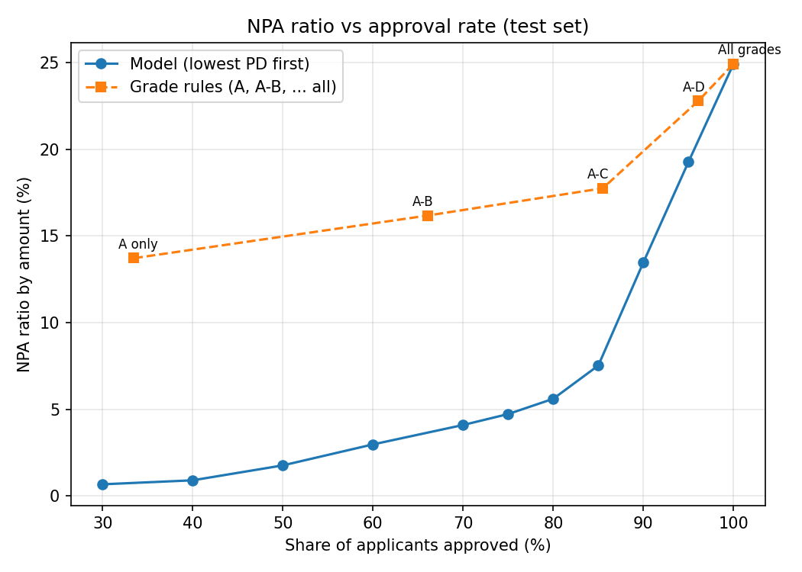

**Reading the chart.** The headline result is the A to C row. This rule approves 85.5% of applicants, and 17.75% of the money lent defaults. Approving the same 85.5% by lowest PD gives 8.12%, which is 54.3% lower (objective 2 asked for at least 30%). The model line lies below the grade line everywhere except at 100% approval, where both approve everyone (24.93%). The gain is largest when the lender is strict (95.3% lower for grade A only) and smallest when it approves almost everyone (9.2% lower for A to D), because there is little left to choose between. The grade line rises slowly to 17.75% at A to C and then faster (22.79% at A to D), in line with the step between grades C and D seen in the EDA.

### 9.4 Policies built on the bands, and the model's NPA curve

| Policy | Approval rate | NPA ratio by amount |
|---|---:|---:|
| Approve everyone | 100.0% | 24.93% |
| Model: APPROVE band only (PD below 0.20) | 75.3% | 4.87% |
| Model: APPROVE and REVIEW bands (PD below 0.50) | 83.6% | 6.59% |
| Grade A to C rule (for comparison) | 85.5% | 17.75% |

**Reading the table.** The band policies give the lender two clear choices. Approving only the APPROVE band keeps the NPA ratio at 4.87% while approving three applicants in four. If the loan officers also approve every REVIEW case, approvals rise to 83.6% and the NPA ratio to 6.59%. That policy approves almost as many applicants as the grade A to C rule (83.6% against 85.5%) with an NPA ratio of 6.59% against 17.75%.

**The model's NPA curve** at other approval rates, on the same test set:

| Approval rate | 30% | 40% | 50% | 60% | 70% | 75% | 80% | 85% | 90% | 95% | 100% |
|---|---:|---:|---:|---:|---:|---:|---:|---:|---:|---:|---:|
| NPA ratio | 0.68% | 0.91% | 1.77% | 2.98% | 4.10% | 4.73% | 5.61% | 7.53% | 13.48% | 19.27% | 24.93% |

**Reading the table.** The NPA ratio stays below 5% up to a 75% approval rate and below 8% at 85%, then rises steeply: 13.48% at 90% and 19.27% at 95%. The last applicants a lender could approve carry most of the risk, so the approval rate is the main lever, and the curve lets a lender pick a rate for a target NPA ratio.

### 9.5 Five-fold cross-validation and ablation

To check that the test result is not a lucky split, each model was also scored with 5-fold stratified cross-validation over all 32,409 cleaned rows (`src/robustness.py`, shuffle seed 7, not the seed of the main split).

| Model | Fold 1 | Fold 2 | Fold 3 | Fold 4 | Fold 5 | Mean | Std. dev. |
|---|---:|---:|---:|---:|---:|---:|---:|
| Logistic regression | 0.8597 | 0.8716 | 0.8730 | 0.8721 | 0.8773 | 0.8707 | 0.0059 |
| Random forest | 0.9310 | 0.9363 | 0.9336 | 0.9317 | 0.9356 | 0.9336 | 0.0021 |
| XGBoost | 0.9456 | 0.9520 | 0.9495 | 0.9491 | 0.9522 | 0.9497 | 0.0024 |

**Reading the table.** Each model's mean AUC is close to its test AUC (XGBoost 0.9497 against 0.9469), and the standard deviation across folds is 0.0024, well under the 0.01 target (objective 6). The worst XGBoost fold (0.9456) is far above 0.85, and the ranking of the models is the same in every fold.

The lender sets the grade and the rate, and both may carry its own judgement. To see how much the model leans on them, XGBoost was retrained without `loan_grade` and `loan_int_rate` and scored on the same test set.

| Model | Test ROC-AUC |
|---|---:|
| XGBoost, all 11 inputs | 0.9469 |
| XGBoost without `loan_grade` and `loan_int_rate` (9 inputs) | 0.9020 |

**Reading the result.** Removing the two columns costs 0.0449 AUC, so the model does use them, but it still clears the 0.85 target. A real lender should decide whether the grade and the rate are available at decision time and whether the model should depend on them.

### 9.6 Note on XGBoost and CPU thread count

The XGBoost settings use `n_jobs=-1`, all CPU threads (16 on this laptop). XGBoost's histogram sums depend on how many threads build them, so results are not bit-for-bit identical across machines. Retraining with 1 to 16 threads gave validation AUC 0.9506 to 0.9523 and test AUC 0.9465 to 0.9478, so the 0.85 target holds at every thread count. The numbers in this report differ from the reference values in the project's build specification by less than 0.001 AUC (validation 0.9511 against 0.9513, test 0.9469 against 0.9478). The PD of the "good" applicant of section 10.4 moves between 0.074 and 0.101, always far below the 0.20 cut-off. A re-run elsewhere may differ in the third or fourth decimal.

---

## 10. Explainability

### 10.1 How the reasons are made

`src/explain.py` wraps SHAP's `TreeExplainer` around the XGBoost step of the pipeline. The pipeline's own preprocessing turns an applicant into 11 numbers, and SHAP returns 11 contributions in log-odds units, one per feature. Log-odds is the scale on which the model adds its trees together: a positive value moves the applicant towards default and a negative value moves it away. The service takes the three largest contributions and keeps only those above zero, so an applicant with few risk-raising features gets fewer than three reasons. Each reason carries the feature name, the applicant's value, the impact and a fixed text phrase.

### 10.2 Global importance

The mean absolute SHAP value of each feature over the 4,862 test loans ranks the features by how much they move predictions.

| Rank | Feature | Mean absolute SHAP (log-odds) | Share of total |
|---:|---|---:|---:|
| 1 | `person_income` | 0.923 | 19.3% |
| 2 | `loan_grade` | 0.892 | 18.7% |
| 3 | `loan_percent_income` | 0.827 | 17.3% |
| 4 | `person_home_ownership` | 0.687 | 14.4% |
| 5 | `loan_intent` | 0.558 | 11.7% |
| 6 | `loan_int_rate` | 0.284 | 5.9% |
| 7 | `loan_amnt` | 0.251 | 5.2% |
| 8 | `person_emp_length` | 0.170 | 3.6% |
| 9 | `person_age` | 0.123 | 2.6% |
| 10 | `cb_person_cred_hist_length` | 0.052 | 1.1% |
| 11 | `cb_person_default_on_file` | 0.013 | 0.3% |

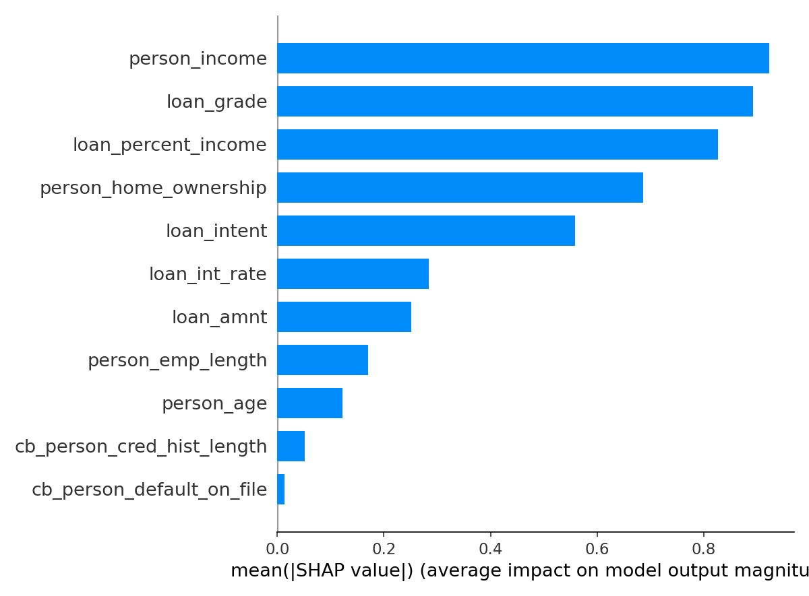

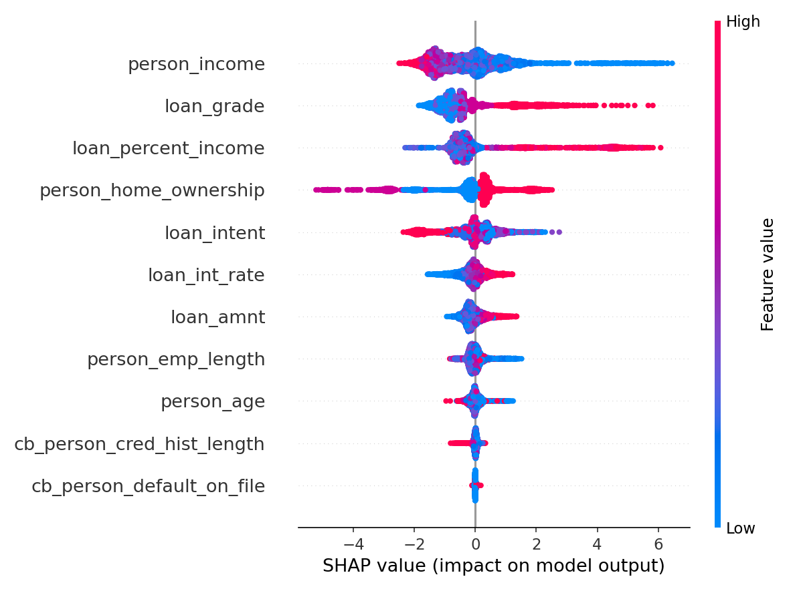

**Reading the charts.** Income, grade and the loan-to-income ratio are the top three and hold 55.3% of the total importance; the top five hold 81.3%. In the beeswarm, low income (blue) pushes towards default, and so do a high loan-to-income ratio (red, up to about +6 in log-odds) and a poor grade (high value, red). The past-default flag has almost no effect (0.013), probably because grades A and B contain no past defaults, so the grade already carries that information. The colours for home ownership and purpose carry no high or low meaning, because those columns are integer codes. SHAP importance says what the model uses, not what causes default.

### 10.3 Base value and additivity

SHAP's base value is the model's average output: −1.289 in log-odds, a probability of about 0.216. The base value plus an applicant's 11 contributions equals that applicant's raw model score. On all 4,862 test loans the largest difference between the sum and the model's own output is 1.34e-05, far below the limit of 0.001 that the test in `tests/test_model.py` enforces (on 200 loans), so the explanation is exact and not an approximation. SHAP fills in its base value only after it has computed values once, so the code reads it after the first `shap_values` call (section 15).

### 10.4 Reason texts and examples

Each feature has a fixed phrase (`REASON_TEXT` in `src/explain.py`) that a loan officer can read to an applicant.

| Feature | Reason text returned |
|---|---|
| `person_income` | Income is low for the amount requested |
| `loan_grade` | Weak credit grade |
| `loan_percent_income` | Loan is large compared with income |
| `person_home_ownership` | Home ownership status |
| `loan_intent` | Purpose of the loan |
| `loan_int_rate` | High interest rate on the loan |
| `loan_amnt` | Large loan amount |
| `person_emp_length` | Short time in current job |
| `person_age` | Age profile |
| `cb_person_cred_hist_length` | Short credit history |
| `cb_person_default_on_file` | Past default on credit file |

Some phrases give no direction ("Home ownership status" appears when renting raises the risk), so a lender's compliance team would need to reword them before real use.

**Examples.** The first row is the riskiest test applicant (`src/explain.py`); the other two were scored by the live service (section 13.3). The approved applicant also gets reasons, but their impacts (0.05 to 0.27) are small next to those of the rejected ones (1.6 to 4.7).

| Applicant | PD, band, decision | Reasons (impact in log-odds) |
|---|---|---|
| Riskiest test applicant: loan is 56% of an income of 14,400, purpose HOMEIMPROVEMENT | Highest PD in the test set | Loan is large compared with income (+4.712); Income is low for the amount requested (+4.309); Purpose of the loan (+2.137) |
| "Good": age 28, income 42,000, RENT, 3 years employed, MEDICAL, grade C, loan 12,000 at 13.5%, no past default, 4 years history | 0.0953, low, APPROVE | Home ownership status (+0.267); Income is low for the amount requested (+0.099); Purpose of the loan (+0.051) |
| "Risky": age 22, income 18,000, RENT, 1 year employed, PERSONAL, grade D, loan 9,000 at 16%, past default Y, 2 years history | 1.0, high, REJECT | Loan is large compared with income (+4.2); Income is low for the amount requested (+3.686); Home ownership status (+1.625) |

---

## 11. System architecture

### 11.1 Data flow diagram, level 0

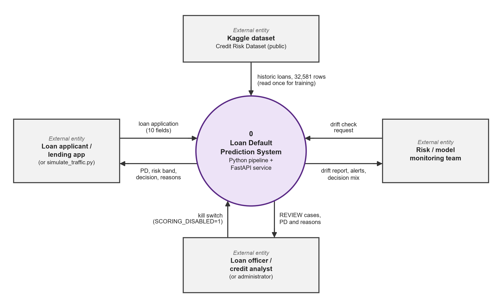

At level 0 the whole system is one process with four external entities. The Kaggle dataset supplies the 32,581 historic loans once, for training. The loan applicant or lending application (or the traffic simulator) sends a loan application of 10 fields and gets back the PD, risk band, decision and reasons. The loan officer or credit analyst receives the REVIEW cases with their PD and reasons, and can switch scoring off with `SCORING_DISABLED=1`. The risk or model-monitoring team sends a drift check request and gets a drift report, alerts and the decision mix.

### 11.2 Data flow diagram, level 1

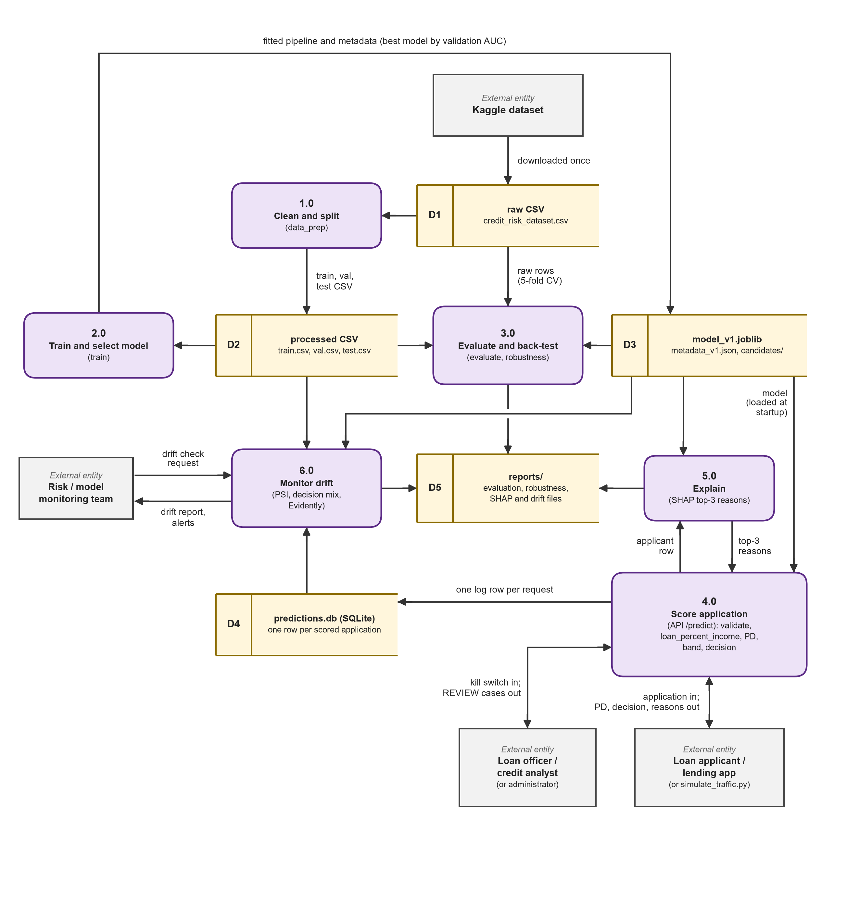

At level 1 the system has six processes and five data stores. Process 1.0 (`data_prep`) cleans the raw CSV (D1) and writes `train.csv`, `val.csv` and `test.csv` (D2). Process 2.0 (`train`) fits the three models on D2 and writes the best pipeline and its metadata (D3). Process 3.0 (`evaluate`, `robustness`) scores the test set and runs cross-validation on the raw rows, and writes its results to `reports/` (D5). Process 4.0 is the `POST /predict` endpoint: it validates the request, computes `loan_percent_income`, loads the model from D3 at start-up, returns the PD, band and decision, and writes one row to the SQLite log (D4). It calls process 5.0 (SHAP) for the top three reasons. Process 6.0 reads the recent rows of D4 and the training data, computes PSI and the decision mix, and returns the drift report and alerts to the monitoring team.

### 11.3 Block diagram

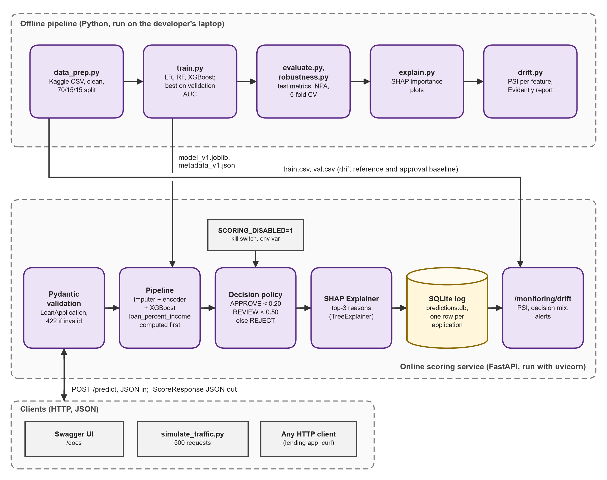

The block diagram shows the same system as modules. The offline pipeline runs in order: `data_prep.py`, `train.py`, `evaluate.py` and `robustness.py`, `explain.py`, `drift.py`. `train.py` hands the model file and metadata to the online service, and `data_prep.py` hands `train.csv` and `val.csv` to the drift endpoint as its reference data and approval baseline. Inside the FastAPI service a request passes through Pydantic validation, the Pipeline, the decision policy (with the kill switch), the SHAP explainer and the SQLite log, and `/monitoring/drift` reads that log. Clients are the Swagger UI, the traffic simulator and any HTTP client.

### 11.4 Layers and the single Pipeline object

| Layer | Technology | Responsibility |
|---|---|---|
| Data preparation | Python 3.13, pandas, scikit-learn | Load the raw CSV, apply the three cleaning rules, make the stratified 70/15/15 split |
| Modelling | scikit-learn, XGBoost, joblib | Train the three pipelines, choose by validation AUC, save the pipeline and its metadata |
| Evaluation | scikit-learn, matplotlib | Test metrics, risk bands, NPA back-test, cross-validation and ablation |
| Explanation | SHAP | Per-feature contributions, top-3 reasons, importance charts |
| Service | FastAPI, Pydantic, uvicorn | Four endpoints, input validation, scoring, decision policy, kill switch |
| Storage | SQLite (`sqlite3`) | One row per scored application |
| Monitoring | NumPy, pandas, Evidently | PSI per feature and on the score, decision-mix alert, HTML report |
| Verification | pytest, FastAPI `TestClient`, httpx | 13 automated tests; traffic simulator for live checks |

**One Pipeline object.** The service has a single dependency on the trained model (section 8.2): one joblib file with preprocessing and model together. Replacing the model means replacing that file and its metadata, and the explainer is built from the same object at start-up, so the reasons always belong to the model that produced the score.

### 11.5 Request flow, decision policy and kill switch

**Request flow of `POST /predict`.**

1. The client sends 10 fields. It does not send `loan_percent_income`.
2. Pydantic checks the types and ranges (age 18 to 100, income above 0, grade A to G and so on). A failure returns HTTP 422 and the model is never called.
3. The service computes `loan_percent_income` = `loan_amnt` / `person_income`, rounded to 2 decimals.
4. The saved pipeline fills missing values, encodes the inputs and returns the PD from XGBoost.
5. The PD is compared with the cut-offs: below 0.20 gives (low, APPROVE), below 0.50 gives (medium, REVIEW), otherwise (high, REJECT).
6. If the kill switch is on, the decision is set to REVIEW. The PD and the band are unchanged.
7. SHAP computes the contributions and the top three positive ones become the reasons.
8. One row (application id, time, model version, the 11 inputs, PD, decision, latency) is written to SQLite.
9. The response returns the id, PD, band, decision, reasons, model version and latency.

**Decision policy and kill switch.** The APPROVE cut-off of 0.20 is the break-even PD at an 11% interest rate and a 45% loss given default (section 4.2). The REJECT cut-off of 0.50 is the point at which a default is more likely than not. Both are constants in `src/config.py`, so a lender can change them without retraining. The kill switch is the environment variable `SCORING_DISABLED=1`, read when the server starts. When it is set every decision becomes REVIEW, so that a person decides, while applications are still scored and logged.

---

## 12. Module descriptions

The system has eleven parts. They are listed in the order in which the data moves through them. Descriptions follow what the code does. Screenshots of the running service and the pipeline runs are in section 12.1.

| # | Module | What it does |
|---|---|---|
| 1 | **`src/config.py`, `src/data_prep.py`** | Central settings (paths, feature lists, seed 42, cut-offs 0.20 and 0.50). Loads the raw CSV (stops with the download link if it is missing), applies the three cleaning rules and writes the stratified `train.csv`, `val.csv` and `test.csv`. |
| 2 | **`src/train.py`** | Builds the three pipelines, fits them on the training rows, scores them on the validation rows, picks the best by ROC-AUC and saves it with its metadata. Also holds the metric function used everywhere (AUC, Gini, PR-AUC, KS, Brier). |
| 3 | **`src/evaluate.py`** | Scores the untouched test set: metrics for all three models, risk bands, NPA back-test by grade rule, policies, the model's NPA curve, the ROC and NPA charts, and `reports/evaluation.json`. |
| 4 | **`src/robustness.py`** | 5-fold cross-validation for each model and the ablation without grade and rate. Writes `reports/robustness.json`. It does not influence model selection. |
| 5 | **`src/explain.py`** | The `Explainer` class (SHAP on the XGBoost step), the reason texts, the importance and beeswarm charts and `reports/shap_importance.json`. |
| 6 | **`src/drift.py`** | PSI for numeric and categorical features and for the PD score, status labels (stable, watch, alert), the stressed "downturn" copy of the data, and the Evidently HTML report. |
| 7 | **`src/api/schemas.py`** | Pydantic models for the request (10 validated fields) and the response (PD, band, decision, reasons, version, latency). |
| 8 | **`src/api/store.py`** | The SQLite prediction log: creates the table, inserts one row per application, reads the most recent rows. Closes every connection explicitly (section 15). |
| 9 | **`src/api/main.py`** | The FastAPI application: loads the model, explainer and reference data once at start-up, serves the four endpoints, applies the decision policy and the kill switch. |
| 10 | **`scripts/simulate_traffic.py`** | Sends test-set applicants to the running API like a loan application would. `--downturn` applies the stress (incomes down 20%, rates up 2 points) and `--n` sets the number of requests. Prints the p50 and p95 round-trip time and the decision mix. |
| 11 | **`tests/`** | 13 pytest tests in three files, with a fixture that sends every test's log to a temporary SQLite file (section 13.2). |

**API endpoints.**

| Method | Path | Purpose |
|---|---|---|
| GET | `/health` | Status, model version and kill-switch state |
| GET | `/model/info` | Training metadata of the deployed model and the policy cut-offs |
| POST | `/predict` | PD, band, decision, up to three reasons and latency; writes one row to the log |
| GET | `/monitoring/drift?last_n=500` | PSI per feature and on the score, decision mix, alerts; HTTP 409 below 100 logged rows |

**Prediction log.** The `predictions` table has one row per scored application with 17 columns: `application_id` (primary key), `created_at`, `model_version`, the 11 model inputs, `pd`, `decision` and `latency_ms`. An index on `created_at` speeds up the "most recent rows" query.

**Drift alerts.** A feature raises an alert when its PSI is 0.25 or more; 0.10 to 0.25 is "watch". The `decision_mix` alert is raised when the share of APPROVE decisions in the window differs by more than 10 points from the baseline, which is the approval share on the validation set (0.75). The endpoint refuses to compute anything with fewer than 100 logged rows, because a PSI on a handful of rows is noise.

---

## 13. Testing approach

Testing has three parts: checks on each pipeline phase, 13 automated tests that run in one command, and live checks of the running service. The model itself is evaluated on a stratified hold-out set that no step of training touched (4,862 loans), with 5-fold cross-validation over all cleaned data as a second view (AUC 0.9497, standard deviation 0.0024). All random seeds are fixed (42 for the split and the models, 7 for the folds, 1 for the traffic sample), so every number in this report can be reproduced, with the thread-count caveat of section 9.6.

### 13.1 Pipeline checks (run)

These checks were run after each phase on 1 November 2026. The "expected" column holds the reference values in the project's build specification, with the tolerance used.

| # | Check | Expected | Actual | Result |
|---|---|---|---|---|
| T1 | Libraries and raw file | All packages import; file is (32,581, 12) | Same; versions as in `requirements.txt` | pass |
| T2 | EDA counts | 25,473 repaid and 7,108 defaulted; 895 and 3,116 missing; 165 duplicates | Same | pass |
| T3 | Cleaning | 32,581 rows to 32,409 | 32,581 to 32,409 | pass |
| T4 | Split | 22,686 / 4,861 / 4,862 rows; 21.9% default in each | Same | pass |
| T5 | Validation AUC | Logistic regression 0.8789 and random forest 0.9368 exact; XGBoost within 0.002 of 0.9513 | 0.8789; 0.9368; 0.9511 (difference 0.0002) | pass |
| T6 | Test AUC and back-test | XGBoost within 0.002 of 0.9478; A to C NPA within 0.3 points of 8.11%; reduction 54.3% | 0.9469 (0.0009); 8.12% (0.01 points); 54.3% | pass |
| T7 | Cross-validation | Standard deviation below 0.01 | 0.0024 (logistic regression 0.8707, random forest 0.9336, XGBoost 0.9497) | pass |
| T8 | SHAP | Same feature order and riskiest applicant; additivity error below 0.001 | Same order and applicant; error 1.34e-05 | pass |
| T9 | API decisions | "Good" APPROVE, "risky" REJECT, age 7 gives 422 | APPROVE (PD 0.0953), REJECT (PD 1.0), HTTP 422 | pass |
| T10 | Offline PSI | The 11 feature PSIs equal the reference; `loan_int_rate` is an alert in the downturn | All 11 equal; `loan_int_rate` 1.1231 (alert) | pass |
| T11 | Live drift | 409 on an empty log; no alert for normal traffic; alerts for the downturn | 409; alerts [] ; `loan_int_rate`, `decision_mix` | pass |
| T12 | Kill switch | Decision REVIEW, application still scored and logged | REVIEW; PD 0.0953; `/health` shows `kill_switch` true | pass |
| T13 | pytest | 13 passed | 13 passed | pass |

### 13.2 Automated tests (pytest)

`python -m pytest -q tests` runs 13 tests in about 19 to 32 seconds (18.70 s in the Phase 9 run, 31.60 s in the saved console output). All use a temporary SQLite file through the fixture in `tests/conftest.py`, so they never write to the real log. The run shows one warning, a deprecation notice from Starlette about using `httpx`, which does not affect the results.

| # | Test | What it checks |
|---|---|---|
| 1 | `test_data.py::test_cleaning_removes_impossible_rows` | 32,409 rows after cleaning; maximum age at most 100; no employment length above 60; no duplicates |
| 2 | `test_data.py::test_splits_are_stratified_and_disjoint` | Split sizes 22,686 / 4,861 / 4,862; default rates within 0.5 points; no loan in two parts |
| 3 | `test_model.py::test_auc_meets_target` | Test ROC-AUC of the saved model is at least 0.85 |
| 4 | `test_model.py::test_shap_values_add_up_to_the_score` | Base value plus SHAP values equals the model's raw output within 1e-3 on 200 loans |
| 5 | `test_model.py::test_probabilities_are_calibrated_by_decile` | In each of 10 score deciles, mean PD and actual default rate differ by at most 0.05 |
| 6 | `test_api.py::test_health` | `/health` returns status ok |
| 7 | `test_api.py::test_predict_valid` | PD between 0 and 1, a valid decision, at most 3 reasons |
| 8 | `test_api.py::test_rejects_bad_age` | Age 7 gives HTTP 422 |
| 9 | `test_api.py::test_rejects_unknown_grade` | Grade "Z" gives HTTP 422 |
| 10 | `test_api.py::test_missing_field` | A request without `loan_amnt` gives HTTP 422 |
| 11 | `test_api.py::test_nullable_fields_accepted` | Null employment length and null interest rate give HTTP 200 |
| 12 | `test_api.py::test_kill_switch_sends_everything_to_review` | With the kill switch on, the decision is REVIEW |
| 13 | `test_api.py::test_drift_endpoint_flags_a_downturn` | After 300 stressed applications, `loan_int_rate` is in the alert list |

### 13.3 Live API test cases

The service was started with uvicorn on port 8000 and called on 1 November 2026. The raw console output is saved in `_evidence/live_api.txt` and `_evidence/kill_switch.txt`. Screenshots of the same checks are in section 12.1.

| # | Request | Expected result | Result |
|---|---|---|---|
| A1 | `GET /health` | HTTP 200, status ok, kill switch off | Pass: status ok, model_version v1, kill_switch false (Figure {{S:02-health.png}}) |
| A2 | `GET /model/info` | Metadata of the deployed model and the policy | Pass: model xgboost, 11 features, 22,686 training rows, approve_below 0.2, reject_from 0.5 (Figure {{S:03-model-info.png}}) |
| A3 | `POST /predict`, the "good" applicant of section 10.4 | Low PD, APPROVE, up to 3 reasons | Pass: PD 0.0953, low, APPROVE, 3 reasons, latency 34.19 ms (Figure {{S:05-predict-good-approve.png}}) |
| A4 | `POST /predict`, the "risky" applicant of section 10.4 | High PD, REJECT, reasons | Pass: PD 1.0, high, REJECT, loan-to-income 0.5 (+4.2), income 18,000 (+3.686), RENT (+1.625), 24.01 ms (Figure {{S:06-predict-risky-reject.png}}) |
| A5 | `POST /predict` with age 7 | HTTP 422, model not called | Pass: HTTP 422, "Input should be greater than or equal to 18" (Figure {{S:07-predict-invalid-422.png}}) |
| A6 | `GET /monitoring/drift` on an empty log | HTTP 409 | Pass: HTTP 409, "Need at least 100 logged predictions, have 0" (Figure {{S:04-drift-409-empty-log.png}}) |
| A7 | 500 normal applicants, then drift | No alerts; p95 below 100 ms | Pass: p50 35.3 ms, p95 45.6 ms; mix APPROVE 0.718, REVIEW 0.098, REJECT 0.184; alerts [] (Figure {{S:08-drift-normal-no-alert.png}}) |
| A8 | 500 downturn applicants, then drift | Alerts on `loan_int_rate` and `decision_mix` | Pass: p95 44.9 ms; mix 0.572 / 0.154 / 0.274; `loan_int_rate` PSI 1.1777; alerts `loan_int_rate`, `decision_mix` (Figure {{S:09-drift-downturn-alerts.png}}) |
| A9 | Server started with `SCORING_DISABLED=1`; `/health`, then the "good" applicant | `kill_switch` true; decision REVIEW; PD still computed and logged | Pass: kill_switch true; PD 0.0953, band low, decision REVIEW, 37.81 ms (Figures {{S:10-kill-switch-health.png}} and {{S:11-kill-switch-predict-review.png}}) |

**Notes on the results.** The latency figures in the table come from the first run saved in `_evidence/live_api.txt`. A second run, whose output is in Figure {{S:17-console-traffic.png}}, gave a p95 of 42.7 ms (normal) and 39.4 ms (downturn). Both runs meet the target of 100 ms, and the run-to-run difference shows the size of the timing noise on a laptop. The p95 is the round trip seen by the client, including HTTP overhead. The service's own `latency_ms` for single requests was 24 to 34 ms. Only the round trip was measured for the 500-request runs. The test cases cover correct behaviour on valid input, rejection of invalid input, monitoring and the kill switch. They do not test load, concurrent users or restarts under traffic.

---

## 14. Results

### 14.1 Objectives against results

| # | Objective | Target | Result | Met |
|---|---|---|---|---|
| 1 | Test ROC-AUC | At least 0.85 | 0.9469 (XGBoost) | Yes |
| 2 | NPA reduction against grade A to C rule | At least 30% | 54.3% lower (17.75% to 8.12%) | Yes |
| 3 | Reasons on REVIEW and REJECT decisions | 100% | 1,201 of 1,201 on the test set | Yes |
| 4 | p95 latency of `POST /predict` | Below 100 ms | 45.6 ms over 500 requests | Yes |
| 5 | Drift alert on downturn traffic | Alert raised, none on normal traffic | `loan_int_rate` PSI 1.178 and `decision_mix`; no alert on normal traffic | Yes |
| 6 | Standard deviation of 5-fold AUC | Below 0.01 | 0.0024 | Yes |
| 7 | Safe operation: validation, log, kill switch | All three work | HTTP 422 on bad input; one row per request logged; kill switch gives REVIEW | Yes |
| 8 | Automated tests | All pass | 13 passed | Yes |

### 14.2 What the numbers mean for the business

- **Less lent money in default for the same volume.** At the grade A to C approval rate, the model cuts the NPA ratio from 17.75% to 8.12%. For every 100 units lent, 9.63 fewer units end up in default. This is a relative gain on one simulated data set, not a forecast.
- **A clear two-step policy.** Approving only the APPROVE band approves 75.3% of applicants at a 4.87% NPA ratio. Adding the REVIEW band raises approvals to 83.6% and the NPA ratio to 6.59%. The 402 REVIEW cases in the test set (8.3%) are the ones a loan officer should read the reasons for. Approving all of them costs 1.72 points of NPA ratio.
- **The model helps most where the lender is strict.** At a low approval rate the model's choice is far better than the grade's (95.3% lower for grade A only), and at a very high approval rate there is little to choose (9.2% lower at 96.1%). A lender that wants to grow approvals should read the NPA curve in section 9.4 to see where the risk starts to rise steeply, between 85% and 95%.
- **Decisions can be explained.** Every REVIEW and REJECT has at least one reason that a loan officer can read out, and the reasons add up exactly to the model's score.
- **A downturn is visible within 500 applications.** Interest-rate PSI moves from 0.012 to 1.178 and approvals fall from 71.8% to 57.2% when incomes fall 20% and rates rise 2 points. Normal traffic raises no alert. The shift shows in the application data, before any of those loans can default.
- **The result depends on the grade and the rate.** Without them the test AUC is 0.9020, still above the target, but it shows how much the model relies on the lender's own earlier judgement.

---

## 15. Challenges and resolutions

| # | Challenge | Resolution |
|---|---|---|
| 1 | XGBoost results change with the number of CPU threads. With `n_jobs=-1` on 16 threads the validation AUC was 0.9511, and 1 to 16 threads gave 0.9506 to 0.9523. The reference values in the build specification could not be reproduced exactly. | Measured the effect (validation AUC 0.9506 to 0.9523, test AUC 0.9465 to 0.9478), kept the specified settings unchanged, accepted a tolerance of 0.002 AUC and reported this machine's numbers with the range (section 9.6). |
| 2 | Evidently 0.7 has a new API. The old `evidently.report` and `evidently.metric_preset` modules no longer exist, so code written for the old API failed on import. | Rewrote `evidently_report()` for the 0.7 API: `Report([DataDriftPreset()])` from `evidently.presets`, `Dataset.from_pandas` with a `DataDefinition`, and `snapshot.save_html()`. The versions are pinned in `requirements.txt`. |
| 3 | SHAP fills in its base value (`expected_value`) lazily. Reading it before the first call to `shap_values` returned the wrong value. | `Explainer.base_value()` is documented to be called only after `shap_values()`, and the test reads it in that order. |
| 4 | SQLite connections on Windows. Python's `with sqlite3.connect()` commits but does not close the connection, and an open handle locks the file on Windows, which stops tests and clean-ups from replacing or deleting the log. | `store.py` wraps every use in a context manager that commits on success, rolls back on error and always closes the connection in `finally`. The tests point the log at a temporary file. |
| 5 | NaN cannot be sent as JSON. Applicants with a missing employment length or interest rate produced NaN, which breaks JSON. | The request schema accepts null for both fields. `plain()` in `explain.py` turns NaN into None in reasons, and `simulate_traffic.py` turns NaN into null before sending. A test checks that nulls are accepted. |
| 6 | Text encoding on Windows. The default encoding of Python file functions on Windows is cp1252, not UTF-8, so a file with other characters can be read or written differently on another machine. | Every read and write names the encoding: `encoding="utf-8"` for CSV and text files. |
| 7 | The dataset is not in the repository. The `data/` folder is git-ignored, so a fresh checkout has no raw file. | `load_raw()` checks that the file exists and stops with the Kaggle link and the exact target path. The README repeats the setup step. |
| 8 | Running the server in the background on Windows for live checks. The server holds port 8000 and the log file, and the drift check needs an empty log at the start. | Each live check started a fresh server, used a fresh log, and stopped the server at the end (the evidence files end with "stopped"). The tests do not need a server: they use `TestClient` and a temporary log. |
| 9 | The default rate of 21.8% is far above a real bank's NPA ratio, so absolute NPA numbers are not realistic. | Reported the relative reduction at a matched approval rate, and said in sections 5.3 and 17 that absolute values do not transfer. |
| 10 | The grade and the rate may carry the lender's own judgement, so a model that uses them may partly copy it. | Ran an ablation without both columns (test AUC 0.9020) and reported it next to the main result (section 9.5). |

---

## 16. Ethics and responsible AI

Credit decisions affect people's access to money, so the ethics of a scoring system are part of its design. This section sets out what the project does and what it does not do.

### 16.1 Data licence, privacy and AI disclosure

- The data is a public Kaggle dataset, used under the licence shown on its page and cited in the references. It is not redistributed with the code.
- The records are simulated credit-bureau data. They have no names, identifiers, addresses or contact details, and there is no row key that points to a person.
- The youngest applicant in the raw file is 20, so the data has no minors. The API accepts ages from 18.
- The prediction log stores the inputs of every scored application. In this project the inputs come from a public test file. In a real deployment the same table would hold personal and financial data and would need access control, retention rules and encryption.
- AI tools used for code and writing are disclosed in Appendix A, as the programme's declaration requires.

### 16.2 Explainable rejections and the RBI Fair Practices Code

A refused applicant has a right to know why, in words and not in model weights. Every response carries up to three reasons, each tied to a fixed text, and the reasons add up exactly to the model's score. This follows the intent of the RBI's Fair Practices Code for lenders, which expects fair treatment and an explanation of a refusal. The wording has weaknesses (section 10.4): some phrases name a feature and not the direction of its effect. A real lender must have compliance staff approve the texts and decide which reasons may be shown to the applicant.

### 16.3 Human oversight, audit log and monitoring

- The REVIEW band (PD from 0.20 to below 0.50) is meant for a person. In the test set it holds 8.3% of applicants (402 loans), and 26.1% of them default.
- The REJECT band (PD of 0.50 or more) is a refusal by the system. A real lender would need an appeal route and a person who can override the model, particularly because 3% of rejected applicants in the test set would have repaid.
- The kill switch (`SCORING_DISABLED=1`) sends every decision to REVIEW after a restart of the service. It is meant for the case where monitoring shows that the model can no longer be trusted. It does not stop scoring or logging.
- Every scored application is written to SQLite with its id, time, model version, inputs, PD, decision and latency. From a row, anyone can reproduce the decision: the same inputs run through the same model version give the same PD, and the reasons can be recomputed from them. The reasons themselves are not stored. The log is a plain database file, written by one process, with no access control and no tamper protection. A real system would need an append-only store with signed records.
- The drift endpoint compares recent applicants with the training data on every feature and on the model score, and flags a change in approval rates. The downturn test (section 13.3) shows that it fires. The thresholds (0.10 and 0.25) are conventions, and the monitor checks inputs and scores, not real outcomes, which arrive months later.

### 16.4 DPDP Act 2023 for a real deployment

India's Digital Personal Data Protection Act, 2023 would apply to a lender that runs a system like this on real applicants. In outline, the lender (the data fiduciary) would need to process personal data only for a lawful purpose, with notice to the applicant and either consent or a use that the Act allows. It would have to keep the data accurate and secure, delete it when the purpose ends, handle access and correction requests, and report breaches. This project holds no personal data, so none of these duties applies to it today. A real deployment would also need to check the current status of the Act's Rules from official sources at that time.

### 16.5 Fairness: not yet audited

No fairness audit has been done. The model uses age, home ownership and loan purpose as inputs. Whether a lender may use them, and whether a feature such as home ownership acts as a proxy for a protected group, must be tested before real use, for example by comparing approval rates and error rates across age bands. The dataset has no gender, religion, caste or location column, so this project cannot measure such differences, and it makes no claim that the model is fair. This is stated as a limitation in section 17.

---

## 17. Limitations and future scope

### 17.1 Limitations

1. **Simulated data.** The Kaggle data simulates credit-bureau records. It is not a real lender's book.
2. **Unrealistic default rate.** The 21.8% default rate is far above the roughly 1.8% gross NPA ratio of Indian banks, so absolute NPA numbers do not transfer. The relative gain between policies is the useful result.
3. **No reject inference.** The back-test sees only loans that were granted and have known outcomes.
4. **No dates.** The data has no time column, so drift is simulated with a stressed copy of the data and the split is random, not by time.
5. **PSI thresholds are conventions.** The limits 0.10 and 0.25 are industry rules of thumb, not statistical tests.
6. **No fairness audit.** There is no check of outcomes across age or other groups.
7. **Result depends on the CPU.** XGBoost results vary slightly with the thread count (test AUC 0.9465 to 0.9478 across 1 to 16 threads on this machine).
8. **Dependence on grade and rate.** Without `loan_grade` and `loan_int_rate` the test AUC falls to 0.9020.
9. **One process, no login.** The service has no authentication, roles or rate limiting. The SQLite log is one file written by one process.
10. **Generic reason texts, no load test.** Some phrases do not give the direction of an effect (section 10.4). Latency was measured with one client; concurrent load was not tested.

### 17.2 Future scope

- **Fairness audit.** Compare approval and error rates across groups, test for proxies of protected attributes and decide which inputs a lender may use.
- **Reject inference.** Estimate outcomes for refused applicants so that the model and the back-test are not limited to granted loans.
- **Calibration monitoring.** Once real outcomes arrive, track predicted PD against the actual default rate by decile, as well as PSI on the inputs.
- **Retraining with approval.** A scheduled job that retrains on new data, compares the new model with the live one on a hold-out set and promotes it only after a person approves.
- **Authentication and an audit store.** API keys or OAuth, roles for loan officers and risk analysts, and an append-only audit log.
- **Time-based validation.** With dated data, split by time so that the test set is the future, and observe drift for real.
- **Reviewed reason texts, hosting and a front end.** Wording approved by compliance, a hosted service and a screen for loan officers that shows the decision, the reasons and the drift status.

---

## 18. References

1. Basel Committee on Banking Supervision. (2005). *An Explanatory Note on the Basel II IRB Risk Weight Functions.* Bank for International Settlements.
2. Breiman, L. (2001). Random forests. *Machine Learning*, 45(1), 5-32.
3. Chen, T., & Guestrin, C. (2016). XGBoost: A scalable tree boosting system. *Proc. 22nd ACM SIGKDD Conference on Knowledge Discovery and Data Mining*, 785-794.
4. Consumer Financial Protection Bureau. *Regulation B, 12 CFR Part 1002, section 1002.9: Notifications.*
5. Digital Personal Data Protection Act, 2023 (Act No. 22 of 2023). Government of India.
6. Fawcett, T. (2006). An introduction to ROC analysis. *Pattern Recognition Letters*, 27(8), 861-874.
7. Friedman, J. H. (2001). Greedy function approximation: A gradient boosting machine. *Annals of Statistics*, 29(5), 1189-1232.
8. Hand, D. J., & Henley, W. E. (1997). Statistical classification methods in consumer credit scoring: A review. *J. Royal Statistical Society: Series A*, 160(3), 523-541.
9. Lessmann, S., Baesens, B., Seow, H.-V., & Thomas, L. C. (2015). Benchmarking state-of-the-art classification algorithms for credit scoring. *European Journal of Operational Research*, 247(1), 124-136.
10. Lundberg, S. M., & Lee, S.-I. (2017). A unified approach to interpreting model predictions. *Advances in Neural Information Processing Systems 30*, 4765-4774.
11. Lundberg, S. M., Erion, G., Chen, H., et al. (2020). From local explanations to global understanding with explainable AI for trees. *Nature Machine Intelligence*, 2(1), 56-67.
12. McKinney, W. (2010). Data structures for statistical computing in Python. *Proceedings of the 9th Python in Science Conference*, 56-61.
13. Pedregosa, F., et al. (2011). Scikit-learn: Machine learning in Python. *Journal of Machine Learning Research*, 12, 2825-2830.
14. Reserve Bank of India. *Fair Practices Code for Lenders*; master circular on income recognition, asset classification and provisioning (NPA norms). rbi.org.in, current version.
15. Siddiqi, N. (2017). *Intelligent Credit Scoring: Building and Implementing Better Credit Risk Scorecards* (2nd ed.). Wiley.
16. Thomas, L. C., Crook, J. N., & Edelman, D. B. (2017). *Credit Scoring and Its Applications* (2nd ed.). SIAM.
17. Yurdakul, B. (2018). *Statistical Properties of Population Stability Index.* Doctoral dissertation, Western Michigan University.
18. laotse. *Credit Risk Dataset.* Kaggle. {{dataset_source}}
19. Documentation: FastAPI (fastapi.tiangolo.com), Evidently (docs.evidentlyai.com), SHAP (shap.readthedocs.io), XGBoost (xgboost.readthedocs.io).

---

## Appendix A: AI tools disclosure

This project was built with AI assistance. The AI tool used was **Claude** (Anthropic), working as a coding assistant. It was used to:

- write and run the Python pipeline (`src/`), the scoring API, the traffic simulator, the automated tests and the EDA notebook;
- run the commands whose console output is saved in `_evidence/` and produce the charts in `reports/`;
- draft this report, the synopsis, the SRS and the README, using numbers produced by the scripts and the files above.

Every number in this report comes from a script run on this project's files, from the saved console output, or from the saved report files. Where a value is not measured, the report says "not measured". The learner, {{learner_name}}, is responsible for the project, for understanding the code and the results, and for explaining them at the expo. The commands in Appendix B reproduce every result.

---

## Appendix B: How to rerun the pipeline

From the project root on Windows (PowerShell). Python 3.11 to 3.14 works and 3.13 is recommended.

```powershell
py -3.13 -m venv .venv
.\.venv\Scripts\python.exe -m pip install -r requirements.txt
# download the Kaggle CSV and save it as data\raw\credit_risk_dataset.csv

.\.venv\Scripts\python.exe -m src.data_prep     # clean + 70/15/15 split
.\.venv\Scripts\python.exe -m src.train         # 3 models, best on validation AUC
.\.venv\Scripts\python.exe -m src.evaluate      # test metrics, bands, NPA back-test
.\.venv\Scripts\python.exe -m src.robustness    # 5-fold CV + ablation
.\.venv\Scripts\python.exe -m src.explain       # SHAP importance + reasons
.\.venv\Scripts\python.exe -m src.drift         # PSI table + Evidently report
.\.venv\Scripts\python.exe -m pytest -q tests   # 13 passed
.\.venv\Scripts\python.exe -m uvicorn src.api.main:app --port 8000
```

Then open http://127.0.0.1:8000/docs. To test monitoring, run `python -m scripts.simulate_traffic --n 500` (normal) and `--downturn` (stress), and call `GET /monitoring/drift?last_n=500`. To test the kill switch, start the server with `$env:SCORING_DISABLED = "1"`.

| File | Role |
|---|---|
| `data/raw/credit_risk_dataset.csv` | Raw Kaggle file (downloaded, not in the repository) |
| `data/processed/train.csv`, `val.csv`, `test.csv` | Cleaned and split data |
| `models/model_v1.joblib`, `models/metadata_v1.json` | Deployed pipeline and its metadata |
| `models/candidates/` | All three trained pipelines |
| `reports/evaluation.json`, `robustness.json`, `shap_importance.json` | Results of the evaluation, cross-validation and SHAP steps |
| `reports/eda/` | Six EDA charts |
| `reports/roc_curves.png`, `npa_vs_approval.png`, `shap_importance_bar.png`, `shap_beeswarm.png` | Result charts |
| `reports/drift_summary.csv`, `reports/drift_report_downturn.html` | PSI table and Evidently report |
| `logs/predictions.db` | SQLite prediction log (created by the API) |
| `notebooks/01_eda.ipynb` | Executed EDA notebook |
| `_evidence/` | Saved console output of every command and live check |
| `BUILD_LOG.md`, `README.md` | Phase-by-phase build record and run instructions |

---

## Appendix C: Deliverables checklist

| HCL deliverable | Status |
|---|---|
| Completed project (working prototype) | Python pipeline in `src/`, FastAPI service in `src/api/`; runs locally (Appendix B) |
| Project report, minimum 8 pages | This document: `{{report_pdf}}` |
| EDA notebook with 3 or more visualisations | `{{file_prefix}}_EDA_Notebook.pdf`, from `notebooks/01_eda.ipynb`, executed, 6 charts |
| Output screenshots | `{{file_prefix}}_Output_Screenshots.pdf` |
| `dataset.csv`, cleaned and pre-processed | `dataset.csv`: 32,409 rows, 12 columns |
| `data_dictionary.csv`, all columns described | `data_dictionary.csv`: 12 columns described |
| Project synopsis | `Project_Synopsis_{{tag}}.pdf` |
| Software requirements specification | `{{file_prefix}}_SRS_{{tag}}.pdf` |
| Source code and deployment sheet | `{{file_prefix}}_Source_Code_and_Deployment.pdf` |
| Demo video (1 to 2 minutes) or live demo at expo | No hosted demo. Live demo at the expo from the local Swagger UI (`python -m uvicorn src.api.main:app --port 8000`, then http://127.0.0.1:8000/docs) |
| Signed Ethical Compliance Declaration | `Ethical_Compliance_Declaration_{{tag}}.pdf`; prepared as a one-page declaration and in section 9 of the synopsis; signed by {{learner_name}} on {{submission_date}} |
| Source code repository | {{repo_url}} |
